# 🏛️ ARCHITECTURE — Harness Engineering Capstone

**Full-size diagrams, data contracts and decision records for Systems 1 and 2.**

> This document is the *engineering annex*. The [README](README.md) is the executive dossier
> (what was built, what it measured, what it proves). This file is where the wiring is drawn at
> full resolution: runtime topology, state machines, data contracts, failure taxonomies and the
> Architecture Decision Records (ADRs) that explain **why** each contract exists.
>
> Every number here is copied from an artifact in `evidence/`. Where an artifact does not record
> a quantity, this document says so instead of deriving it — an estimate presented as a measurement
> is the one thing a harness engineer is never allowed to ship.

---

## 0. How to read this document

| If you want… | Go to |
|---|---|
| The three-layer model behind both systems | [§1](#1-the-three-layer-stack) |
| How System 1 spends a turn, byte by byte | [§2.1](#21-runtime-topology)–[§2.4](#24-the-tool-lattice) |
| Why the loop can never hang or lie | [§2.2](#22-the-control-loop-full) |
| The claim lifecycle and its terminal guarantee | [§2.6](#26-claim-lifecycle) |
| How System 2 sheds 21,807 tokens without losing answers | [§3.1](#31-data-flow-with-token-annotations)–[§3.4](#34-token-waterfall) |
| The ablation that makes 6/6 mean something | [§3.5](#35-evaluation-and-ablation) |
| The decisions, stated as ADRs | [§4.3](#43-architecture-decision-records) |
| What could still be wrong | [§6](#6-threats-to-validity) |

---

## 1. The three-layer stack

Both systems are the same architecture with different payloads: a **model** that judges, a
**harness** that guarantees, and an **orchestration** layer that persists. The capstone's whole
argument is that reliability comes from the boundary between these layers being explicit.

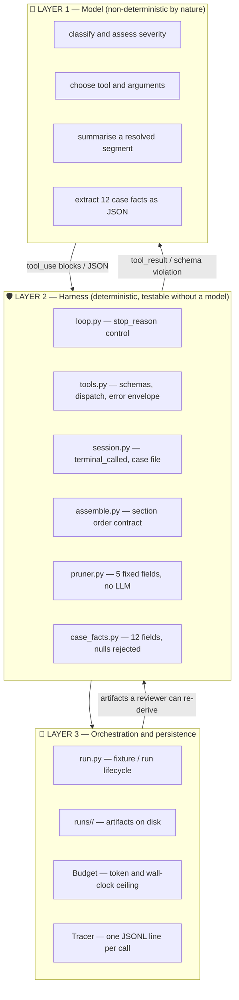

| Boundary | Direction | Contract |
|---|---|---|
| Model → Harness | inbound | The model may only speak in `tool_use` blocks or a final message. There is no free-form control channel. |
| Harness → Model | outbound | Tool results are JSON, and failures are **typed** (`is_error`, `error_category`, `is_retryable`). |
| Harness → Orchestration | downward | Every decision leaves an artifact: a trace line, a queue record, an escalation, a budget. |
| Orchestration → Harness | upward | Budgets and run directories bound what the harness may do; the harness may not exceed them. |

---

# 2. SYSTEM 1 — Claims Intake Agent

## 2.1 Runtime topology

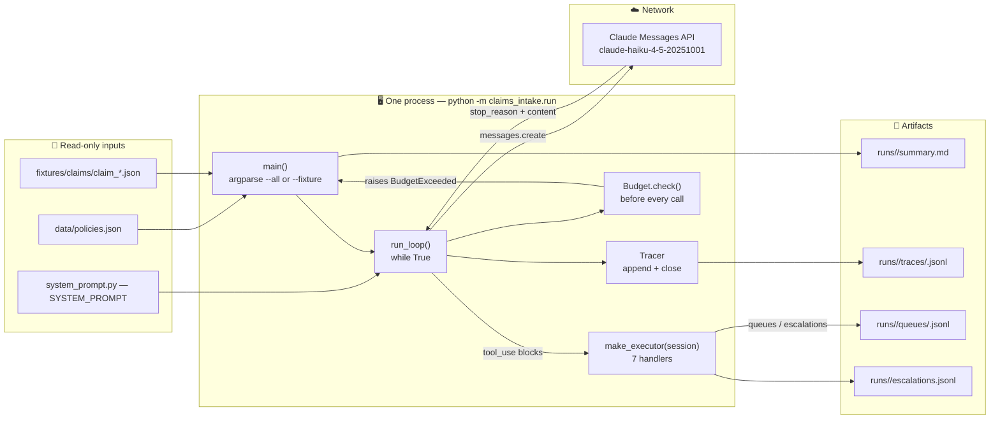

**Default envelopes** (from `run.py` argparse): `--max-input-tokens 500000`,
`--max-wall-clock-s 180.0`, loop `max_tokens=4096`, per-claim `Budget` instance.

## 2.2 The control loop, full

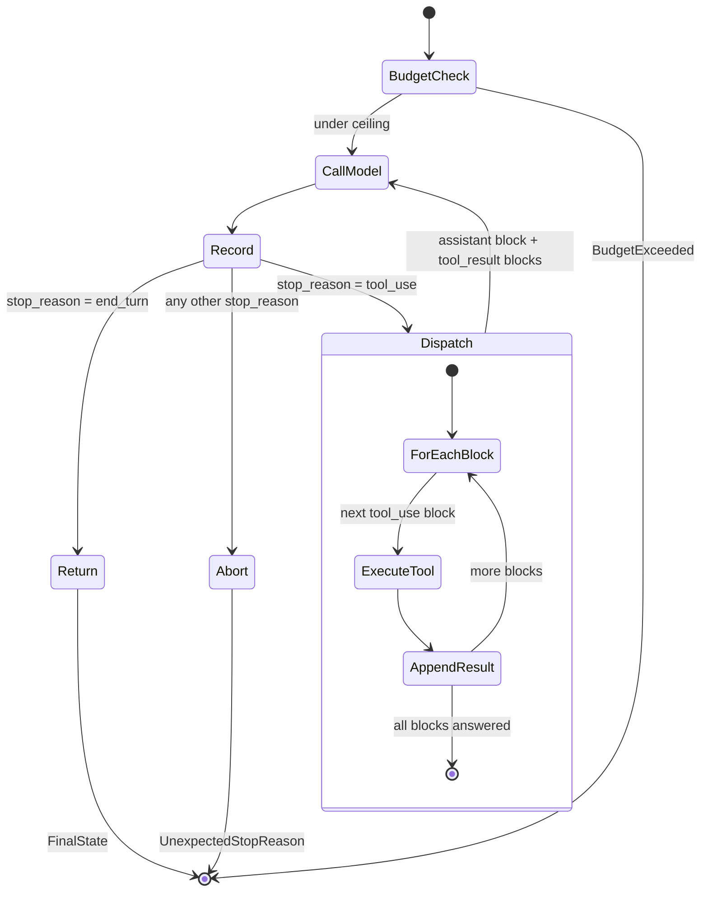

Three invariants the diagram encodes, each of which is a test:

1. **Exactly one exit per call.** Every `CallModel` produces one `Record`; `Record` has three and
   only three outgoing edges. `test_loop.py` asserts the raise path, not just the happy path.
2. **`BudgetCheck` precedes `CallModel`.** The ceiling is enforced *before* spending, so
   `BudgetExceeded` is never raised after an irreversible API call.
3. **The loop has no counter.** There is no `turn < N` edge anywhere in the graph — termination is
   semantic (`end_turn`) or exceptional (`BudgetExceeded`, `UnexpectedStopReason`).

`Record` is where observability happens: the tracer line is written **before** branching, so a run
that dies in `Dispatch` still has a trace line for the call that produced it.

## 2.3 One turn, in wire order

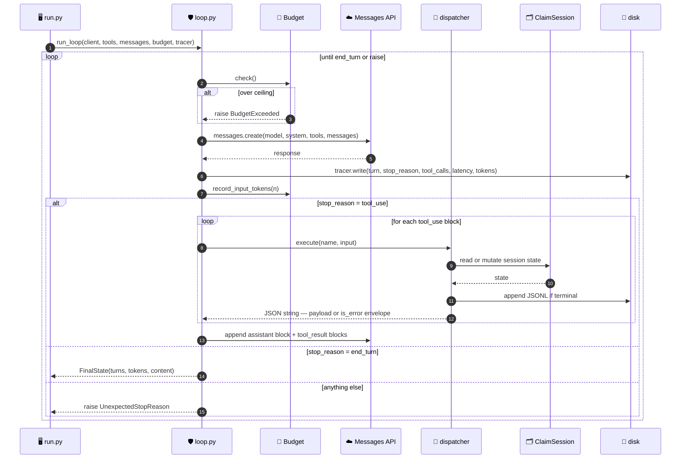

Note the two details that matter in production: the tracer write happens **before** the branch (so
control-flow evidence survives a crash), and the dispatcher **never raises** into the loop — a
handler exception is converted to a `transient` envelope inside `make_executor`.

## 2.4 The tool lattice

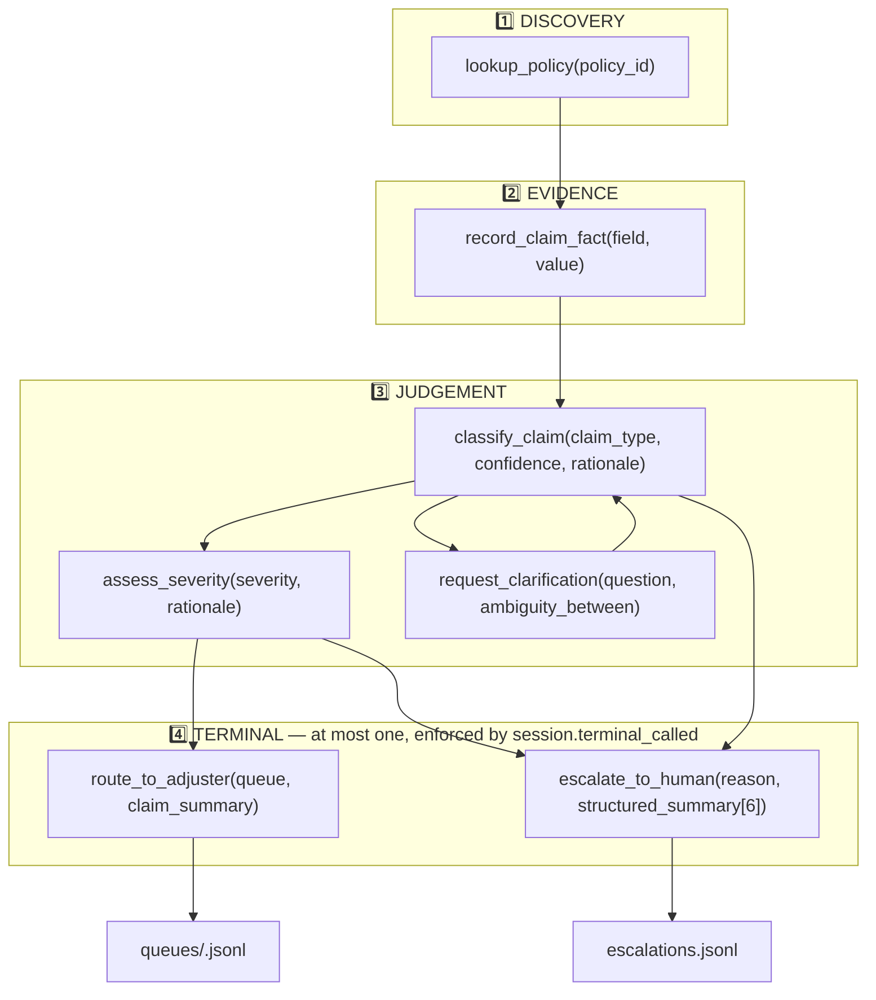

| Slot | Precondition enforced in code | Failure if violated |
|---|---|---|
| `route_to_adjuster` | `classification != None` **and** `severity != None` | `permanent` error: `classify_claim must be called before routing` |
| `route_to_adjuster` | `queue ∈ {property_damage, theft, liability, auto}` | `permanent` error listing the enum |
| `escalate_to_human` | `structured_summary` has **all 6** keys | `permanent` error naming the missing keys |
| either terminal | `terminal_called == False` | `permanent` error: `terminal tool already called this claim` |

The two terminal tools are deliberately **not** interchangeable:
`route_to_adjuster` asserts *"I know the answer"*, `escalate_to_human` asserts *"I know I don't"*.
Escalation carries a `confidence` **and** `candidate_claim_types`, so a human reviewer receives the
model's uncertainty as data rather than as prose.

## 2.5 Error decision tree

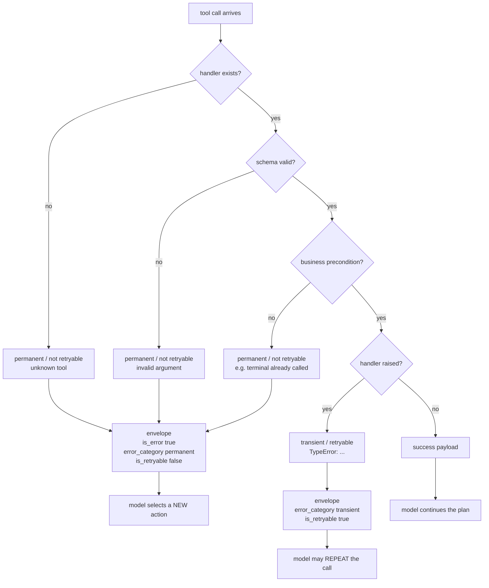

This tree is the reason the tool layer can be tested without a model: every leaf is reachable by
calling `make_executor(session)` directly. All 12 cases in `test_tools.py` are leaves of this graph.

## 2.6 Claim lifecycle

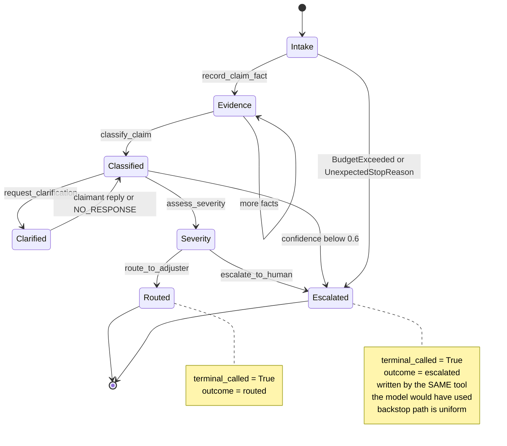

The important structural detail: `Escalated` has a **backstop ingress** (`Intake → Escalated`) that
the model cannot reach. The harness can always terminate a claim; the model cannot always be
trusted to. That asymmetry is the design.

## 2.7 Data contracts

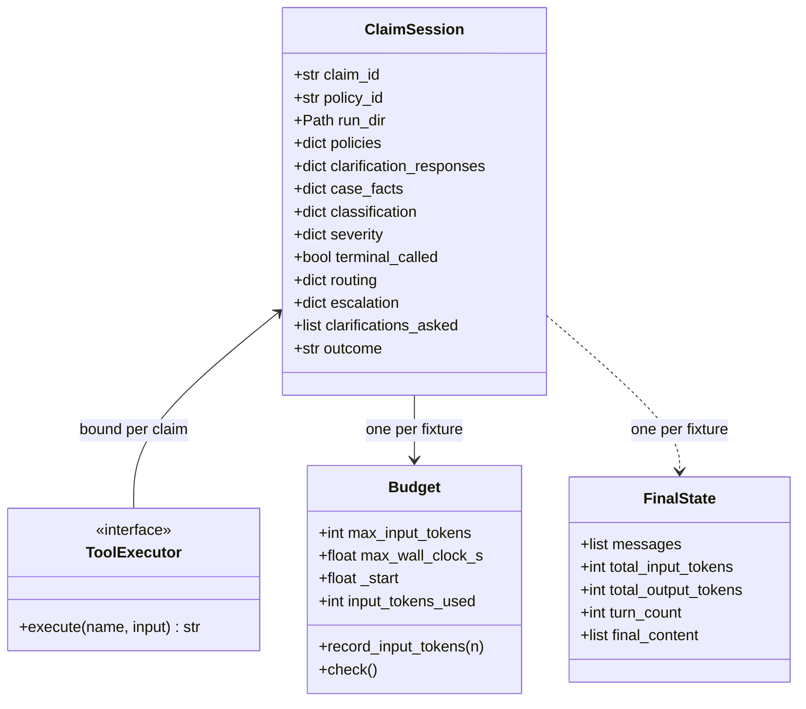

`FinalState` is the **only** thing the loop returns, and it deliberately contains no outcome
verdict. Whether the claim was decided is a property of `ClaimSession`, evaluated by the harness
after the loop — because the loop must not be allowed to grade its own homework.

## 2.8 Artifact DAG

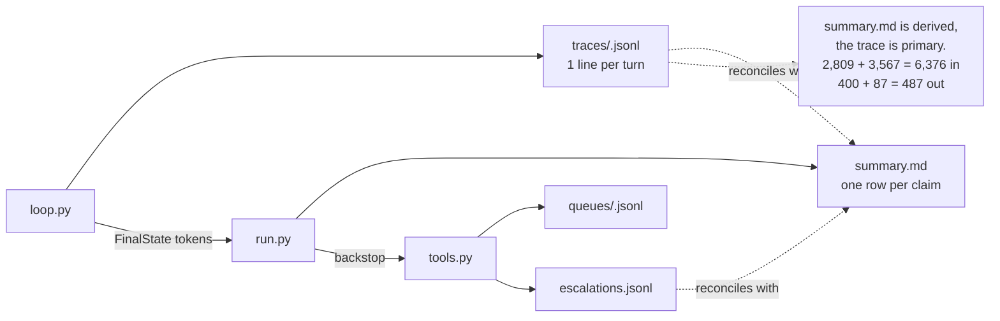

---

# 3. SYSTEM 2 — Retail Support Context Strategy

## 3.1 Data flow with token annotations

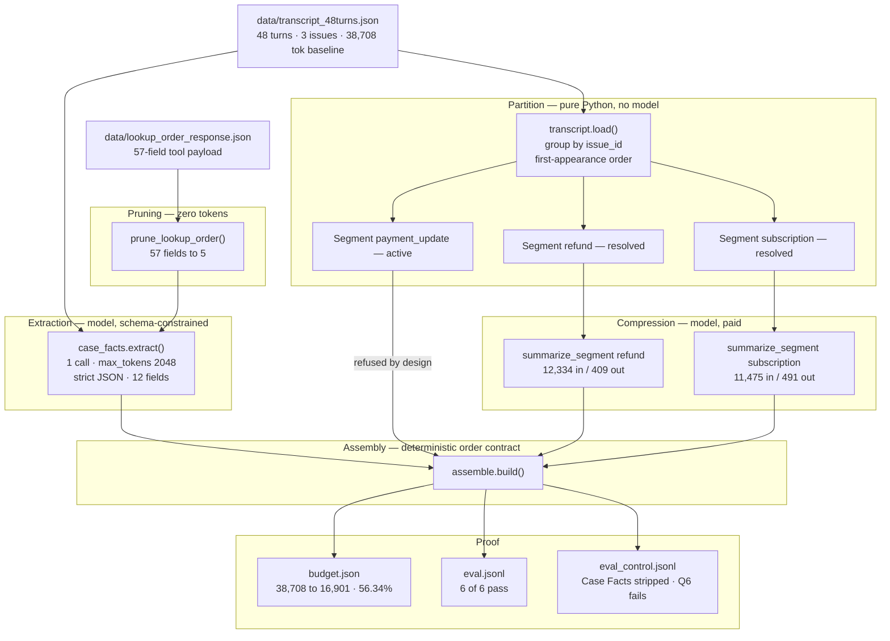

Two edges carry the design intent: `S3 → A` is labelled **refused by design** (the compressor raises
if asked to compress the active segment), and `PR → CF` shows pruning happening *before* extraction,
so the extractor never sees 57 fields of noise.

## 3.2 Segmentation of 48 turns

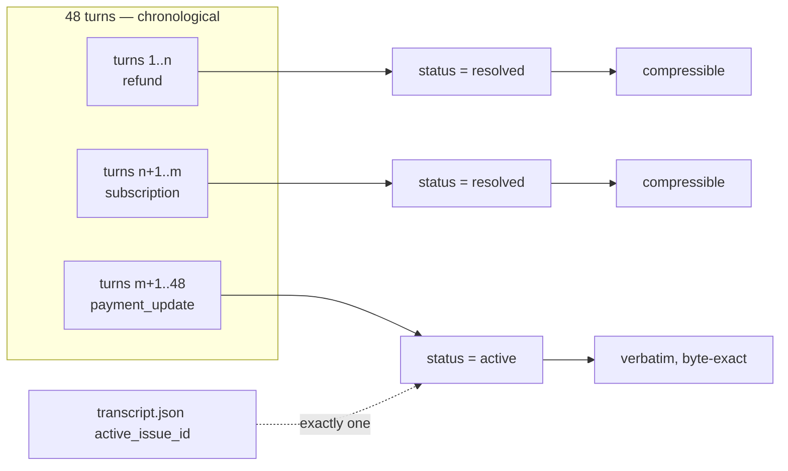

Segmentation is by `issue_id`, **not** by turn index: `active_turns` searches for the segment whose
status is `active` and raises `RuntimeError` if there is none. Order of first appearance is preserved
by an explicit `order` list, so a dict-iteration change can never reorder the assembly.

## 3.3 Assembly anatomy with caps

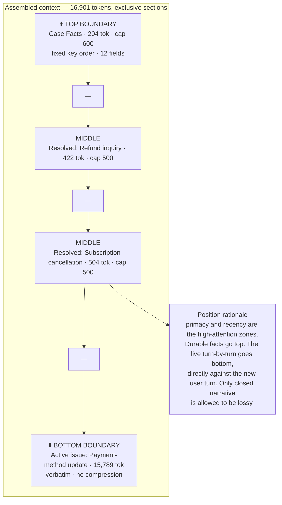

The caps are not advisory: `budget.json` reports per-section counts, and
`test_antipatterns.py::test_budget_json_section_counts_sum_consistently` audits the accounting when
run artifacts are present.

## 3.4 Token waterfall

| Stage | Tokens | Recorded where | Precision |
|---|---:|---|---|
| Baseline 48-turn transcript | **38,708** | `budget.json::baseline_tokens` | measured |
| Compression call — refund | 12,334 in → 409 out | `budget.json::compression_api.refund` | measured (includes compressor system prompt) |
| Compression call — subscription | 11,475 in → 491 out | `budget.json::compression_api.subscription` | measured (includes compressor system prompt) |
| Assembled — `case_facts` | **204** | `budget.json::per_section_tokens` | measured |
| Assembled — `resolved_refund` | **422** | idem | measured |
| Assembled — `resolved_subscription` | **504** | idem | measured |
| Assembled — `active` | **15,789** | idem | measured |
| Assembled total | **16,901** | `budget.json::assembled_tokens` | measured on final markdown |
| Reduction | **−56.34 %** | `budget.json::reduction_pct` | derived from two measured values |

> **Deliberately absent: pre-compression segment sizes.** The artifact records what the compressor
> *consumed*, which includes its system prompt — not the raw segment length. Deriving segment size by
> subtracting the prompt would be an estimate dressed as a measurement, so this document reports the
> recorded number and names its composition. The 18-token delta between the sum of sections (16,919)
> and the assembled total (16,901) is likewise reported, not smoothed: each section count includes
> its own heading.

## 3.5 Evaluation and ablation

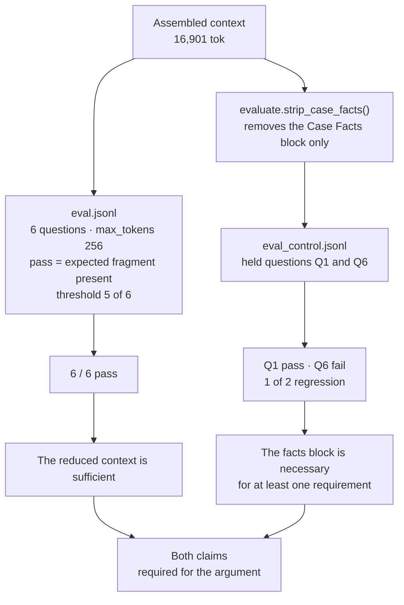

The control is a **single-component ablation** with held questions. That is what converts *"the model
answered 6/6"* (weak: it might have answered from the verbatim active block) into *"removing this one
block destroys Q6"* (causal). The recorded control answer is the evidence:

> *"[…] there is no structured status token recorded for the payment-method update issue. […] The
> payment-method update issue is labeled as 'Active issue' but no specific status token or case code
> is present in the structured record."*

Q1 survives because the refund amount also lives in the resolved narrative. Q6 dies because
`in_progress` **as a status token** existed only in the facts block. The asymmetry is the finding.

## 3.6 Data contracts

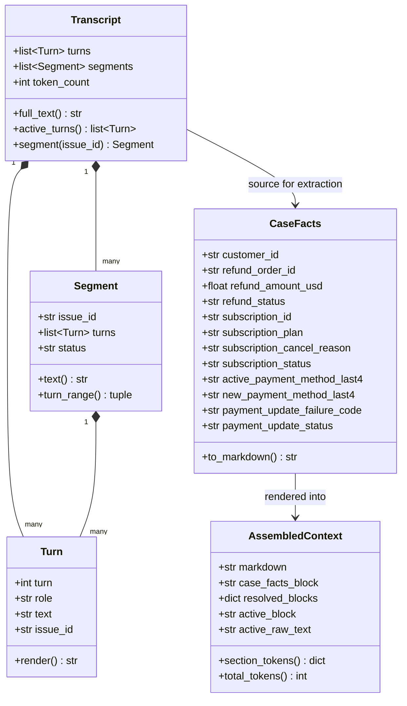

`Transcript.token_count` is lazily cached (`_token_count`), and `count()` itself is `lru_cache`d at
4096 entries — both because the same strings are measured repeatedly during assembly and a second
counting path is how budgets start disagreeing with themselves.

---

# 4. Cross-cutting concerns

## 4.1 The determinism boundary

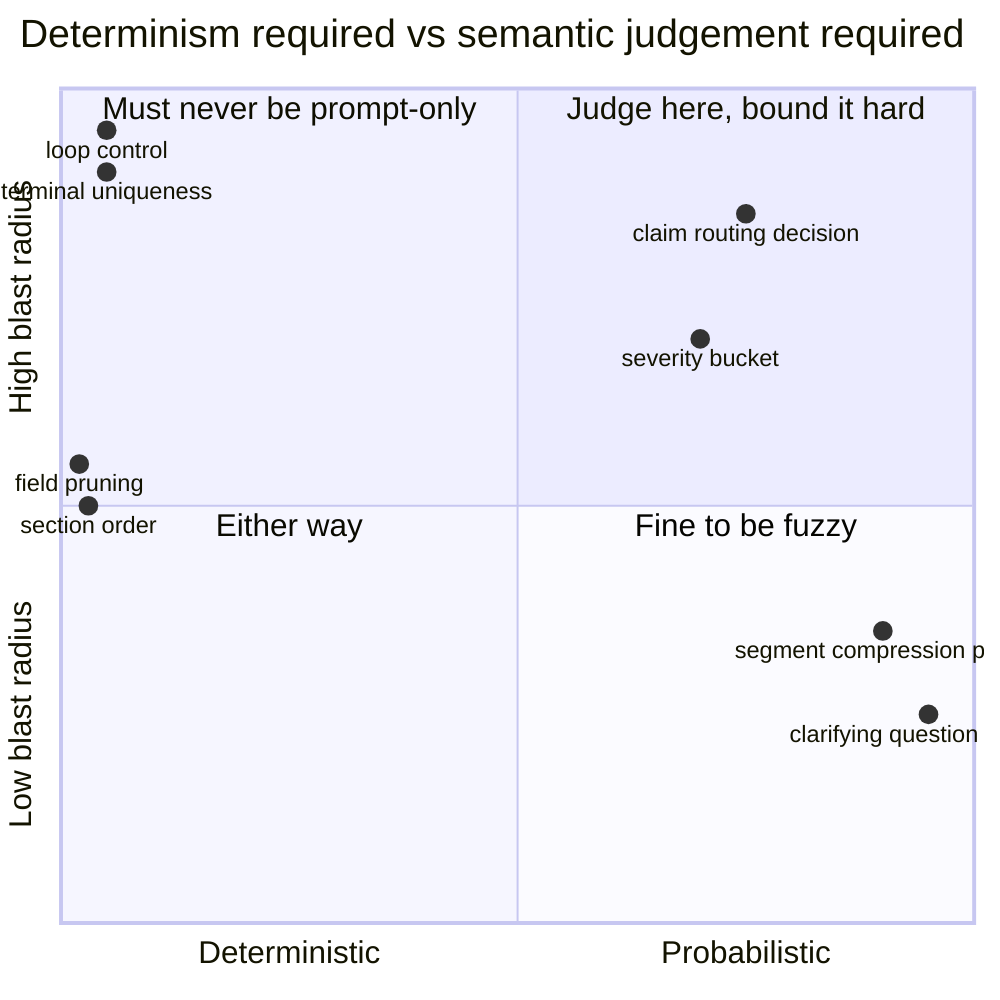

| Contract | Implementation | Enforcement |
|---|---|---|
| Loop continues only on `tool_use` | code | `test_stop_reason_is_loop_control` |
| No string-matching on model prose | code | `test_no_string_membership_against_text_in_loop` (AST audit) |
| One terminal action per claim | code | `test_tools.py` double-terminal case |
| A claim is never left undecided | code | `test_run_backstop.py` |
| Tool failures are typed | code | `test_tools.py` envelope cases |
| Pruning is not probabilistic | code | `test_pruner_has_no_anthropic_import` (AST audit) |
| One token counter only | code | `test_only_tokens_module_uses_count_tokens_or_heuristic` |
| Section order and exclusivity | code | `test_assemble_module_section_order_contract` |
| *Which* claim type, *which* severity | prompt + enum schema | schema rejection at the tool boundary |
| *Which* facts are durable | prompt + schema, then structural validation | `CaseFactExtractionError` on any null |

## 4.2 Failure-mode catalogue

| Failure | Detected by | Behaviour | Artifact evidence |
|---|---|---|---|
| Model ends turn without deciding | backstop after loop | escalated via the real terminal tool | `summary.md` row with empty `claim_type` |
| Model calls a terminal tool twice | `terminal_called` guard | `permanent` error, no duplicate record | `test_tools.py` |
| Tool handler raises | `make_executor` catch | `transient / retryable` envelope | `test_tools.py` |
| Runaway spend | `Budget.check()` before every call | `BudgetExceeded`, exit path preserving traces | `test_loop.py` |
| `stop_reason` unexpected | explicit branch | `UnexpectedStopReason`, no partial success | `test_loop.py` |
| Extraction returns null field | `CaseFactExtractionError` | run aborts loudly, lists the gaps | `test_case_facts.py` |
| Pruner input incomplete | `PrunerMissingFieldError` | abort, never a silent partial dict | `test_pruner.py` |
| Asked to compress the active segment | explicit refusal | `ValueError`, active text stays verbatim | `test_compressor.py` |

## 4.3 Architecture Decision Records

### ADR-001 — `stop_reason` is the only control signal
**Context.** Agents routinely branch on the presence of keywords in model prose.
**Decision.** Control flow reads `response.stop_reason` only; unexpected values raise.
**Consequence.** Wording changes cannot alter control flow. Adding a new stop reason is a code change,
which is the point: it forces a human decision instead of a silent behavioural drift.

### ADR-002 — no iteration cap; a Budget is the ceiling
**Context.** `while turn < 10` is the most common way to "fix" non-termination.
**Decision.** No counter. A `Budget` with token and wall-clock limits raises before each call.
**Consequence.** Non-termination surfaces as a typed exception with a trace, not as a truncated run
that looks successful.

### ADR-003 — terminal tools are two, and neither implies the other
**Context.** One `finish(status=...)` tool makes the model guess the taxonomy.
**Decision.** `route_to_adjuster` and `escalate_to_human` are separate, with distinct preconditions.
**Consequence.** Routing cannot occur without classification and severity; escalation carries
`confidence` and `candidate_claim_types` so a human receives uncertainty as structured data.

### ADR-004 — the backstop lives in code and reuses the model's tool
**Context.** `end_turn` proves the turn ended, not that the claim was decided.
**Decision.** After the loop, if no terminal tool ran, call `escalate_to_human` through the dispatcher.
**Consequence.** One artifact schema for both paths; `exit 1` keeps a silent non-decision visible.

### ADR-005 — case facts are extracted, validated, then placed at the top
**Context.** Compressing a 48-turn transcript loses exactly the tokens the live issue needs.
**Decision.** Extract 12 fields in one call, reject any null, render them at the top boundary.
**Consequence.** Structured status survives compression; the cost is one extra call and a hard
failure mode when the extraction is incomplete (chosen over a silent `None`).

### ADR-006 — pruning is a dict comprehension, not a model call
**Context.** A 57-field tool payload could be "summarised" by the model.
**Decision.** Keep 5 named fields deterministically; the module has no `anthropic` import.
**Consequence.** Zero tokens, zero variance, and an AST audit that keeps it that way.

### ADR-007 — one token counter, methodology recorded
**Context.** Two counters produce two budgets and an unauditable claim.
**Decision.** All measurement through `tokens.count()`; the active backend is written into
`budget.json`.
**Consequence.** Numbers are reproducible or explicitly labelled heuristic; a second path fails an
AST audit.

---

# 5. Verification matrix

| Claim | Proof | Where |
|---|---|---|
| Loop obeys `stop_reason` | 5 loop tests + recorded 2-turn trace | `test_loop.py` · `traces/claim_01_kitchen_fire.jsonl` |
| Tool contract holds | 12 tool tests | `test_tools.py` |
| Backstop fires | 1 test + a real escalated claim | `test_run_backstop.py` · `summary.md` |
| Token accounting reconciles | trace sums equal summary totals | `2,809+3,567=6,376` · `400+87=487` |
| Context reduced without loss | 6/6 eval + 1/2 control regression | `eval.jsonl` · `eval_control.jsonl` |
| Assembly order is a contract | 3 assembly tests + AST audit | `test_assemble.py` · `test_antipatterns.py` |
| Extraction cannot silently fail | 5 case-fact tests | `test_case_facts.py` |
| Submission complete | audit gate | `submission/final-capstone-audit.txt` → **PASS** |

---

# 6. Threats to validity

| Threat | Reality | Mitigation in this pack |
|---|---|---|
| **Partial workspace checkout** | The environment used for the recorded runs held only part of the course tree (disk-size constraints). Artifact-dependent audits therefore **skip**, they do not fail: `test_assembled_context_active_segment_byte_exact` and `test_budget_json_section_counts_sum_consistently` need a `runs/` directory that was not present at test time. | Reported as `28 passed, 2 skipped` — never as "all green". The two audits did execute against the run documented here, whose artifacts are committed. |
| One fixture executed end-to-end | Only `claim_01_kitchen_fire` has a recorded trace; the other fixtures are covered by schema and loop tests. | Stated in the README and here; the routed path is exercised by `test_tools.py`, not by a recorded run. |
| Single model, single sample | All measurements are `claude-haiku-4-5-20251001`, one run each. | Numbers are presented as measurements of *this* run, not as benchmarks. |
| Token heuristic | `len(text)/3.8` when no API key is present. | The methodology string is written into `budget.json`; the recorded System 2 run used the model-authoritative endpoint. |
| Systems 3 and 4 | Analysed in the reflection brief, no artifacts here. | Declared in the README scope table; the audit reports no missing required evidence. |
| Mermaid rendering | Diagrams are linted structurally (fenced blocks balanced, `subgraph`/`end` paired, no reserved characters in labels) but were not rasterised in this environment. | If a diagram fails to render on GitHub, the surrounding tables carry the same information. |

---

Engineering annex · Harness Engineering capstone · Ivo Sánchez Molinero ·
numbers reproduced from <code>evidence/</code>, not from memory.

