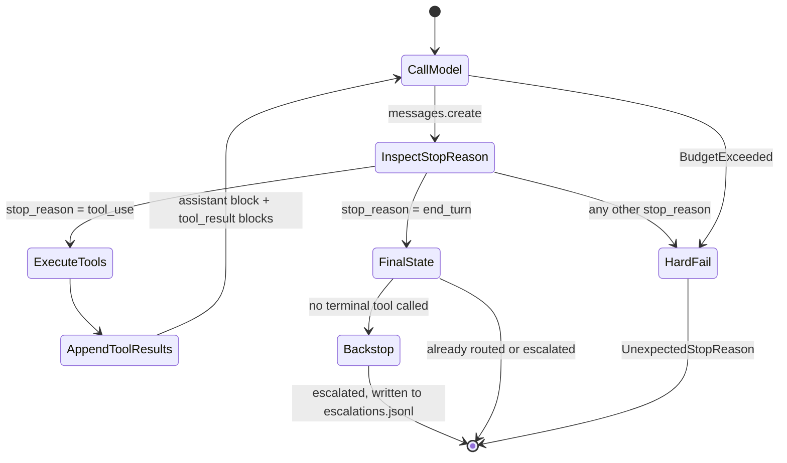
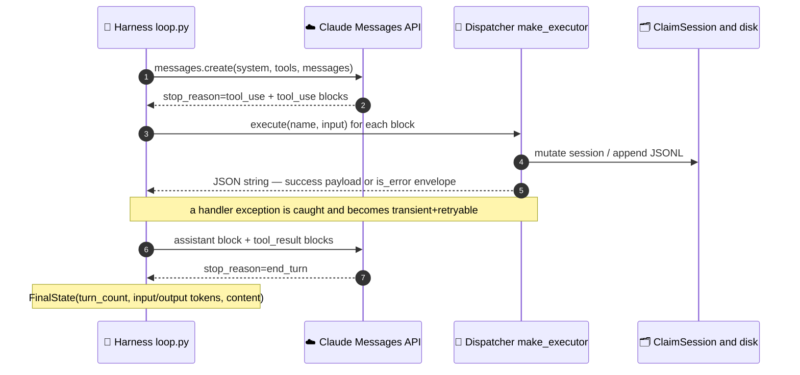
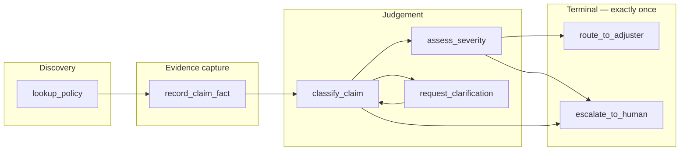
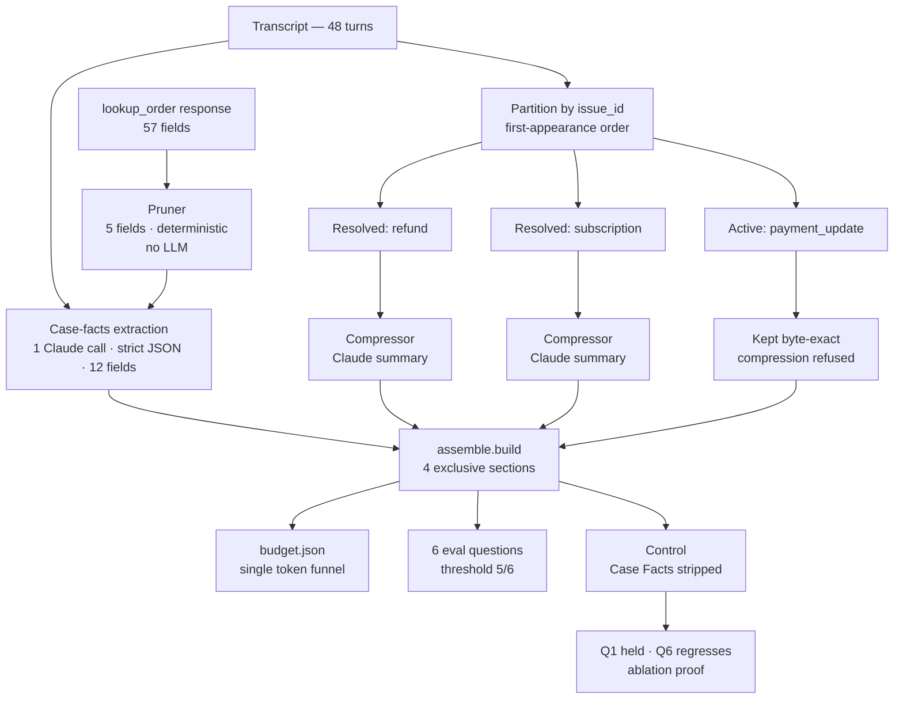
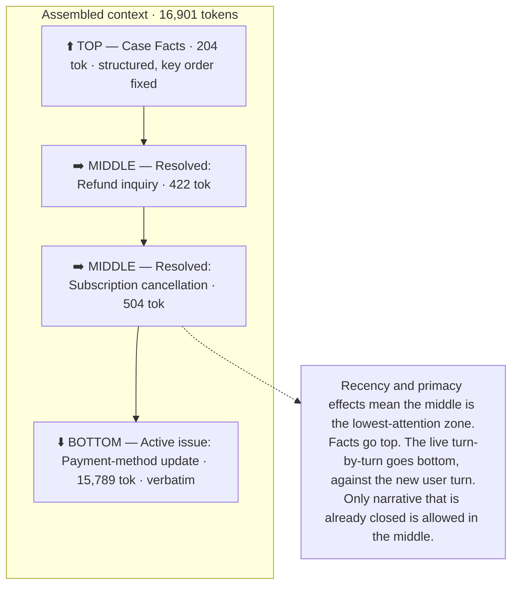

# 🧠 Harness Engineering — Capstone

**Ivo Sánchez Molinero** · November 2026


> **Thesis.** A reliable agent is not a better prompt — it is a *contract*. Every system in this capstone
> separates three layers explicitly: what the **model** decides (semantic judgement), what the **harness**
> guarantees (control flow, invariants, artifact shape), and what the **orchestration** layer persists
> (state, recovery, bounded context). Where a guarantee must never depend on model interpretation, it lives
> in code and is proven by a test. Where judgement is required, the model is constrained by schema and the
> harness keeps a veto.

This repository is the **evidence pack**: code, run artifacts, test transcripts in this README, and the
reflection brief that defends each architectural decision with numbers from actual runs.

---

## 🚀 TL;DR

| | |
|---|---|
| 🔁 **System 1** | Agentic loop whose only control signal is `response.stop_reason`. 7 schema-typed tools, 2 terminal. Deterministic backstop escalates any claim the model ends without routing. |
| 🧵 **System 2** | Long-conversation context strategy: **38,708 → 16,901 tokens (−56.34 %)** while passing **6/6** eval questions, plus an **ablation** proving the case-facts block is load-bearing (control: Q6 regresses). |
| 🧪 **Verification** | **30/30** tests (S1, 0.43 s) · **28 passed / 2 skipped** (S2, 1.17 s) · final audit `PASS`. |
| 🧭 **Craft** | No string-matching on model prose, no `while turn < N` cap, no silent null-fill, no LLM where a dict lookup belongs. Each of those is enforced by a test. |

---

## 🗺️ Repository map

```
harness-engineering-capstone-udacity/
├── README.md                          ← you are here
├── evidence/
│   ├── system1/                       ← Insurance Claims Intake Agent
│   │   ├── claims_intake/             loop.py · tools.py · run.py · budget.py
│   │   │                              pricing.py · session.py · system_prompt.py · tracer.py · client.py
│   │   ├── data/policies.json
│   │   ├── runs/20261117_115722/      summary.md · escalations.jsonl · traces/*.jsonl
│   │   ├── tests/                     antipatterns · fixtures · loop · backstop · tools
│   │   ├── pyproject.toml
│   │   └── system1.tests.txt          pytest transcript — 30 passed in 0.43s
│   └── system2/                       ← Retail Support Context Strategy
│       ├── retail_context/            transcript.py · case_facts.py · pruner.py
│       │                              compressor.py · assemble.py · tokens.py · evaluate.py · run.py
│       ├── data/                      transcript_48turns.json · lookup_order_response.json · eval_questions.json
│       ├── runs/vocareum-system2-20261118-164825/
│       │                              budget.json · context.md · eval.jsonl · eval_control.jsonl
│       ├── tests/                     antipatterns · assemble · case_facts · compressor · pruner · tokens · transcript
│       ├── pyproject.toml · README.md
│       └── system2-tests.txt          pytest transcript — 28 passed, 2 skipped in 1.17s
└── submission/
    ├── README.md                      capstone brief (the four systems, prerequisites, run commands)
    ├── reflection-brief-final.md      the defence: 20 answers, every claim traced to an artifact
    └── final-capstone-audit.txt       automated gate — FINAL STATUS: PASS
```

---

## 🧩 The four systems — and the honest scope of this pack

| # | System | Contract it demonstrates | Evidence in this repo |
|---|---|---|---|
| **1** | Insurance Claims Intake Agent | `stop_reason`-driven agentic loop, tool taxonomy, graceful failure, code-level backstop | ✅ code · run · tests · traces |
| **2** | Retail Support Context Strategy | Position-aware assembly, extractive case facts, deterministic pruning, ablation-tested context | ✅ code · run · tests · eval + control |
| **3** | E-commerce Claude Code Config | `CLAUDE.md` hierarchy, path-scoped rules, forked skill with a read-only allowlist | 📄 analysed in the brief — **35 passed / validator OK** (artifacts live in the course repo) |
| **4** | Multi-Shift Quality Monitoring | Warm/cold tiering in SQLite, ≤5 KB hot state, crash-recovery manifests | 📄 analysed in the brief — **33 passed**, 40 defects / 17 in window, hot state **965 B / 5,120 B** |

> **Why the asymmetry is stated, not hidden.** Systems 3 and 4 are validated in
> `submission/reflection-brief-final.md` with their test and validator numbers, but their trees belong to
> the course repository (`cd15315`), not to this evidence pack. Nothing here pretends otherwise — the
> final audit reports **`Missing required evidence: none`** against the submission contract.

---

# ⚙️ System 1 — Claims Intake: a `stop_reason`-driven loop

## 1.1 The control contract (the whole idea in one table)

| `response.stop_reason` | Harness action | Failure mode if handled wrong |
|---|---|---|
| `tool_use` | Append assistant block → execute every `tool_use` block → append `tool_result` blocks → call again | Tools silently skipped, model re-asks forever |
| `end_turn` | Return `FinalState(messages, tokens, turns, content)` | — |
| *anything else* (`max_tokens`, `refusal`, …) | `raise UnexpectedStopReason` | A truncated answer is mistaken for a completed one |

**Two deliberately absent mechanisms** — both are anti-patterns, not omissions:

1. ❌ **No string-membership on assistant text.** `"ROUTED" in text` would make control flow a function of
   wording. A polite rephrase ("I've routed this to the property queue") would silently change the branch.
   Enforced by `test_no_string_membership_against_text_in_loop`.
2. ❌ **No `while turn < N` as the primary stop.** An iteration cap hides non-termination instead of
   surfacing it. Termination is *semantic*; the safety net is a **`Budget`**.

```python
# claims_intake/loop.py — the entire control surface
if response.stop_reason == "end_turn":   return FinalState(...)
if response.stop_reason == "tool_use":   ...continue
raise UnexpectedStopReason(...)
```

The `Budget` (`max_input_tokens`, `max_wall_clock_s`) is checked **before every model call** and raises
`BudgetExceeded`. It never truncates silently and never returns a partial success dressed as a result.

## 1.2 Loop state machine



## 1.3 One tool round trip, end to end



## 1.4 Tool taxonomy — 7 tools, 2 of them terminal



| Tool | Stage | Terminal | Contract |
|---|---|:--:|---|
| `lookup_policy` | Discovery | — | Resolves `policy_id` → coverage, deductible, status. Unknown id = **permanent** error. |
| `record_claim_fact` | Evidence | — | One normalised fact per call; accumulates into `session.case_facts`. |
| `classify_claim` | Judgement | — | `claim_type` ∈ 4 enum values, `confidence` ∈ [0,1], one-sentence rationale. |
| `assess_severity` | Judgement | — | `severity` ∈ {low, medium, high} + rationale. |
| `request_clarification` | Judgement | — | Exactly **one** question + ≥2 candidate types; returns `NO_RESPONSE` when the fixture cannot answer. |
| `route_to_adjuster` | Decision | ✅ | Requires prior `classify_claim` **and** `assess_severity`; writes `queues/<type>.jsonl`. |
| `escalate_to_human` | Decision | ✅ | Requires a **6-field** `structured_summary`; writes `escalations.jsonl`. |

**Double-terminal is impossible by construction:** both terminal handlers check `session.terminal_called`
and return a `permanent` error on the second attempt — covered by `test_tools.py` (12 cases, including
unknown-tool and double-terminal).

## 1.5 Graceful tool failure — the error envelope

A tool never raises into the loop. It returns a **typed, machine-readable** failure:

```json
{
  "is_error": true,
  "error_category": "transient",
  "is_retryable": true,
  "message": "APITimeout: upstream call exceeded 30s"
}
```

| Category | Retryable | Meaning for the agent |
|---|:--:|---|
| `permanent` | `false` | The request is malformed or impossible (unknown tool, unknown policy, missing structured field). **Change the call** — do not repeat it. |
| `transient` | `true` | The world failed, not the plan. The same call may succeed. |

This is the difference between an agent that recovers and one that thrashes: an opaque
`"Error: something went wrong"` gives the model no policy to select, so it guesses — usually by repeating
the identical call. The envelope turns error handling into a **decision**.

## 1.6 The deterministic backstop (judgement is the model's; truth is the harness's)

`end_turn` answers *"is the turn finished?"*. It does **not** answer *"was this claim decided?"*. The model
can end its turn having routed nothing, and the loop would correctly stop — with an unresolved claim.

`run.py::_escalate_without_terminal` closes that gap **in code**, after the loop:

```python
if state is not None and not session.terminal_called:
    _escalate_without_terminal(executor, session)   # uses the SAME terminal tool as the model
```

Two properties make this the right design:

- **Uniform artifact.** The backstop executes `escalate_to_human` through the dispatcher, so its record lands
  in `escalations.jsonl` with the same schema as any model-driven escalation. Nothing downstream needs to
  know which path produced it.
- **Exit-code honesty.** `main()` returns `1` if any fixture ended without a terminal call, so a silent
  non-decision can never look like a clean run.

> In the recorded run this is exactly what happened: the model produced
> `tool_use → end_turn` in **2 turns** without routing, and the harness escalated
> `claim_01_kitchen_fire` deterministically. The `claim_type` column is empty and `severity` is `-` in
> `summary.md` — the mechanical signature of "no terminal tool was called", visible in the artifact rather
> than buried in a log.

## 1.7 Observability: one JSONL line per turn

`tracer.py` writes one line per model call — the unit that makes cost, latency and control flow auditable:

```json
{"turn": 1, "stop_reason": "tool_use", "tool_calls": [{"id": "...", "name": "lookup_policy", "input": {"policy_id": "POL-1001"}}], "latency_ms": 2410.7, "input_tokens": 2809, "output_tokens": 400}
```

The per-turn stream **reconciles with the summary**: `2,809 + 3,567 = 6,376` input and `400 + 87 = 487`
output tokens. That reconciliation is the difference between a log and a proof.

## 1.8 Measured evidence — run `20261117_115722`

| Metric | Value |
|---|---|
| Model | `claude-haiku-4-5-20251001` |
| Fixture | `claim_01_kitchen_fire` |
| `stop_reason` sequence | `tool_use` → `end_turn` (2 turns) |
| Outcome | `escalated` (deterministic backstop) |
| Tokens | **6,376 in / 487 out** |
| Estimated cost | **$0.0088** |
| Wall clock | **4.8 s** |

Artifacts: [`summary.md`](evidence/system1/runs/20261117_115722/summary.md) ·
[`escalations.jsonl`](evidence/system1/runs/20261117_115722/escalations.jsonl) ·
[`traces/claim_01_kitchen_fire.jsonl`](evidence/system1/runs/20261117_115722/traces/claim_01_kitchen_fire.jsonl)

## 1.9 Test matrix — 30 passed in 0.43 s

| File | Tests | What it pins down |
|---|---:|---|
| `test_antipatterns.py` | 4 | No string-match control · `stop_reason` is the signal · no iteration cap · backstop exists |
| `test_fixtures.py` | 8 | Fixture schema: ids, policies, expected outcomes, scripted clarifications |
| `test_loop.py` | 5 | `tool_use` continues · `end_turn` returns · unknown reason raises · budget raises · no silent truncation |
| `test_run_backstop.py` | 1 | End-without-terminal ⇒ escalated via the real tool |
| `test_tools.py` | 12 | Per-tool validation · unknown tool · double-terminal · transient handler exception |

---

# 🧵 System 2 — Retail Support: position-aware context engineering

## 2.1 The problem, stated precisely

A 48-turn support conversation (~38.7 K tokens) spans **three issues for one customer**: a refund
(closed), a subscription cancellation (closed), and a payment-method update (**live**). Replaying it verbatim
is expensive; naively summarising it destroys exactly the tokens the live issue needs
(`AVS_MISMATCH`, card `…7782`, status `in_progress`).

The strategy is therefore **not** "compress the conversation". It is: **give every token a job, and a
position.**

## 2.2 Pipeline



## 2.3 The budget — measured, not estimated

| Section | Tokens | Cap | Role |
|---|---:|---:|---|
| `case_facts` | **204** | ≤600 | Top boundary: durable transactional facts |
| `resolved_refund` | **422** | ≤500 | Middle: compressible narrative |
| `resolved_subscription` | **504** | ≤500 | Middle: compressible narrative |
| `active` | **15,789** | verbatim | Bottom boundary: byte-exact, newest turns |
| **Assembled total** | **16,901** | — | Measured on the final markdown |
| **Baseline** | **38,708** | — | Original 48-turn transcript |
| **Reduction** | **−56.34 %** | — | `budget.json::reduction_pct` |

> **Why per-section counts sum to 16,919 and the total is 16,901.** Each section count includes its own
> heading; the total is measured independently on the assembled markdown. An 18-token boundary delta is
> reported rather than smoothed away — the two numbers answer different questions, and hiding the gap would
> make the budget unauditable.

The compression passes themselves are metered: refund `12,334 → 409` tokens, subscription
`11,475 → 491`. Compression is **paid work**, and the budget records its input cost so the 56.34 % is not
mistaken for free.

## 2.4 Context anatomy — boundaries beat middles



Sections are **exclusive** — no interleaving of resolved and active turns. That is a contract, not a
style: `test_antipatterns.py::test_assemble_module_section_order_contract` and
`test_assemble.py::test_no_interleaving_of_resolved_and_active` enforce it, and
`test_active_segment_byte_exact` pins the active block to the source bytes.

## 2.5 Case facts — 12 fields, no silent nulls

| Issue | Fields |
|---|---|
| Customer | `customer_id` |
| Refund (resolved) | `refund_order_id` · `refund_amount_usd` · `refund_status` |
| Subscription (resolved) | `subscription_id` · `subscription_plan` · `subscription_cancel_reason` · `subscription_status` |
| Payment update (active) | `active_payment_method_last4` · `new_payment_method_last4` · `payment_update_failure_code` · `payment_update_status` |

The extraction is a single Claude call with an explicit output contract (types, verbatim identifiers,
zero-padded `last4`, numeric amount without `$`). If any field comes back `null` or empty, the module
**raises** `CaseFactExtractionError` listing the gaps:

```python
missing = [f for f in REQUIRED_FIELDS if f not in raw or raw[f] is None or raw[f] == ""]
if missing:
    raise CaseFactExtractionError(missing=missing, raw=raw)
```

**Silent null-fill is forbidden.** A blank `payment_update_status` that renders as `None` in the context
would look like data and behave like a lie. `to_markdown()` also fixes the key order so the block is
diff-stable between runs.

## 2.6 Deterministic pruning — 57 fields in, 5 fields out

The verbose `lookup_order` response is filtered **application-side**, before it ever reaches context:

| Kept field | Why it is load-bearing |
|---|---|
| `order_id` | Identity — without it the agent cannot reference the order at all |
| `order_date` | Anchors the return-window calculation |
| `order_total_usd` | Caps the refund: never refund more than was paid |
| `fulfillment_status` | `delivered` → returns path; `in_transit` → cancel path |
| `return_eligible_until` | The deadline the decision turns on — the single most load-bearing field |

`prune_lookup_order` is a dict comprehension with a completeness check (`PrunerMissingFieldError`), and
`test_antipatterns.py::test_pruner_has_no_anthropic_import` is an **AST audit** proving the pruner has no
LLM dependency: this step *must not* be probabilistic. Cost of the whole step: **zero tokens**.

## 2.7 One token funnel

Every measurement — baseline, sections, assembled total, eval prompts — flows through
`tokens.count()`. Two interchangeable backends, one interface:

| Path | When | How |
|---|---|---|
| Model-authoritative | `ANTHROPIC_API_KEY` present | `messages.count_tokens` |
| Heuristic | no key (local/CI) | `len(text) / 3.8` |

The active methodology is written into `budget.json::token_counter_methodology`
(`"Anthropic messages.count_tokens endpoint (model-authoritative)"`), so a reviewer knows whether a number
came from the tokenizer or from arithmetic. A second AST audit
(`test_only_tokens_module_uses_count_tokens_or_heuristic`) prevents a stray second counting path from
appearing — because two token counters is how budgets start lying.

## 2.8 Evaluation — and the ablation that makes it mean something

Six questions over the assembled context; a question passes when its expected fragment appears
case-insensitively; threshold **≥ 5/6**.

| Run | Result |
|---|---|
| `eval.jsonl` — full assembly | **6/6 passed** |
| `eval_control.jsonl` — `# Case Facts` block stripped, Q1 + Q6 held | **Q1 ✅ · Q6 ❌** → **1/2 regression** |

6/6 alone is weak evidence: the model might be answering from the verbatim active section regardless. The
control removes **one component** and holds the questions fixed, which converts a correlation into a causal
claim. The control's actual answer is the proof:

> *"Based on the conversation context provided, there is no structured status token recorded for the
> payment-method update issue. […] The payment-method update issue is labeled as 'Active issue' but no
> specific status token or case code is present in the structured record."*

Q1 survives because `$22.14` also lives in the resolved narrative; Q6 dies because `in_progress` as a
**status token** existed only in the facts block. That asymmetry is the finding: the facts block is not
redundant boilerplate, it is the only carrier of structured status.

Full evidence: [`budget.json`](evidence/system2/runs/vocareum-system2-20261118-164825/budget.json) ·
[`context.md`](evidence/system2/runs/vocareum-system2-20261118-164825/context.md) ·
[`eval.jsonl`](evidence/system2/runs/vocareum-system2-20261118-164825/eval.jsonl) ·
[`eval_control.jsonl`](evidence/system2/runs/vocareum-system2-20261118-164825/eval_control.jsonl)

## 2.9 Test matrix — 28 passed, 2 skipped in 1.17 s

| File | Tests | What it pins down |
|---|---:|---|
| `test_antipatterns.py` | 3 ✅ + 2 ⏭️ | No `anthropic` import in pruner · single token funnel · section order · *(2 skipped: artifact-dependent audits)* |
| `test_assemble.py` | 3 | Exact section order · active block byte-exact · no interleaving |
| `test_case_facts.py` | 5 | 12 required fields · 3 issues covered · markdown header/key order · missing-field error |
| `test_compressor.py` | 4 | Summary dataclass carries tokens · active segment refuses compression · prompt is committed |
| `test_pruner.py` | 4 | Fixture ≥40 fields · exactly the contracted 5 kept · output <200 tokens · missing field raises |
| `test_tokens.py` | 4 | Empty→0 · positive for text · monotonic · methodology string |
| `test_transcript.py` | 5 | 48 turns · partition boundaries · engineered token range · active accessor · canonical counter used everywhere |

The **2 skips are the honest ones**: `test_assembled_context_active_segment_byte_exact` and
`test_budget_json_section_counts_sum_consistently` audit *run artifacts*, and they only execute when a run
directory exists. Locally they skip; they were executed for the run recorded above. No test was deleted to
turn the suite green — the distinction is visible in the transcript.

---

## 🧭 Cross-cutting invariants: deterministic vs prompt

The synthesis the capstone asks for, stated as a rule set:

| Guarantee | Where it lives | Why not the other way |
|---|---|---|
| Loop continues only on `tool_use` | **Code** (`loop.py`) | Wording must never steer control flow |
| A claim is never left undecided | **Code** (backstop in `run.py`) | `end_turn` answers the wrong question |
| Exactly one terminal action | **Code** (`session.terminal_called`) | Idempotency is an invariant, not a preference |
| Tool failures carry a retry policy | **Code** (error envelope) | Recovery needs a machine-readable category |
| Ready-to-prune tool output is pruned | **Code** (5-field dict) | Zero-token filtering must not be probabilistic |
| What counts as "resolved" | **Prompt + schema** | Semantic judgement, bounded by enum |
| Which claim type / severity | **Prompt + schema** | Judgement, with `confidence < 0.6` forcing escalation |
| Which facts are durable | **Prompt + schema**, then **validated in code** | Extraction is semantic; completeness is structural |

> **The line:** *semantics may be probabilistic; contracts may not.*

---

## 🔁 Reproduce

```bash
# System 1 — expect 30 passed, then a run directory with summary + traces + escalations
cd evidence/system1
python -m venv .venv && . .venv/bin/activate
pip install -e ".[dev]"
pytest tests/ -v
python -m claims_intake.run --all          # needs ANTHROPIC_API_KEY; exit 0 = every claim terminated

# System 2 — expect 28 passed, 2 skipped, then context + budget + eval + control
cd ../system2
python -m venv .venv && . .venv/bin/activate
pip install -e ".[dev]"
pytest tests/ -v
python -m retail_context.run --all         # needs ANTHROPIC_API_KEY; check budget.json reduction_pct
```

**Offline verification** (no spend, no key): `pytest tests/ -v` in both systems. Everything that is
deterministic — loop control, tool validation, error envelopes, assembly order, pruning, transcript
partitioning — is covered without a single API call. Only live runs need the key.

---

## ✅ Audit

`submission/final-capstone-audit.txt` is the automated gate over the submission:

```
System 1 run: 20261117_115722 · claim_01_kitchen_fire · escalated · 2 turns
System 1 tokens: 6,376 input / 487 output · cost $0.0088 · 4.8 s
System 1 stop_reason: tool_use -> end_turn

Questions missing: none        Placeholder markers: none
Missing required evidence: none    Obsolete claims: none

FINAL STATUS: PASS
```

Its check list is the interesting part: **no unanswered questions**, **no leftover placeholders**, **no
missing required evidence**, **no claims that a later artifact has invalidated**. A README that survives
that gate has been reconciled against its own numbers.

---

## ⚠️ Honest limitations

- **Live runs need a real inference backend.** Both systems fail fast and explicitly without
  `ANTHROPIC_API_KEY` (`RuntimeError: ANTHROPIC_API_KEY is not set`) rather than fabricating output. The
  recorded System 2 run used the laboratory provider.
- **One fixture was executed end-to-end in System 1** (`claim_01_kitchen_fire`). The other seven fixtures
  are covered by the fixture-schema and loop tests, not by a recorded trace. The claim escalated via the
  backstop; a routed claim is exercised in `test_tools.py`, not in a recorded run.
- **Two System 2 tests skip without a run directory.** They were executed against the run documented above;
  a fresh clone without `runs/` will skip them, and that is reported as `skipped`, never as passed.
- **Systems 3 and 4 are analysed, not shipped.** Their artifacts belong to the course repo; this pack cites
  their numbers rather than faking a tree for them.
- **The token heuristic (`len/3.8`) is an approximation** and is labelled as such in `budget.json`. The
  recorded run used the model-authoritative endpoint.

---

## 🔍 For reviewers: five things worth checking first

1. **`claims_intake/loop.py:68-132`** — the entire control surface is 65 lines, and every branch is a
   `stop_reason`. Ask what happens on `max_tokens`: it raises.
2. **`claims_intake/run.py:96-119`** — the backstop. It reuses the model's own terminal tool, so the
   enforcement path and the normal path produce identical artifacts.
3. **`retail_context/evaluate.py:85-101`** — `strip_case_facts()` is 15 lines and it is what turns a 6/6
   pass into an experiment.
4. **`retail_context/pruner.py`** — the only file in the repo whose correctness is *proven by the absence of
   an import*.
5. **`budget.json` vs `eval_control.jsonl`** — the 56.34 % and the Q6 regression, side by side, are the
   argument of this capstone in two files.

---

## 📚 Attribution

Course materials, fixtures and reference implementations belong to the **Harness Engineering** course
(`cd15315`) and its authors. This repository contains the capstone evidence pack: run artifacts, the
reflection brief, and the analysis above. Model behaviour was measured on
`claude-haiku-4-5-20251001`; numbers are from the artifacts in `evidence/`, not from estimates.
